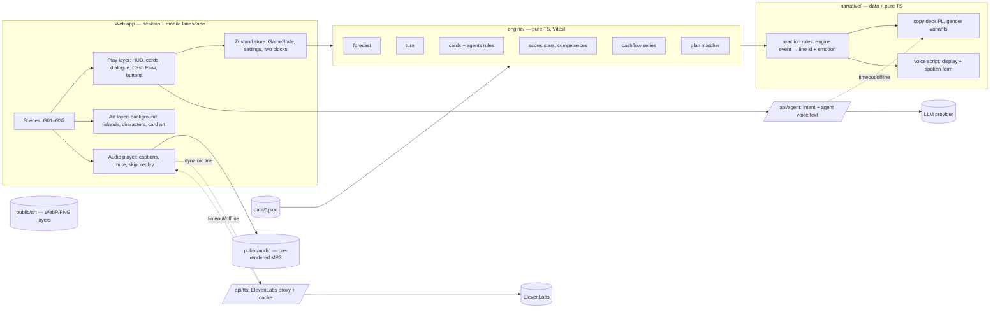

# Architecture — 48 h build

Principle: **one Next.js web app; a deterministic engine in pure TypeScript owns every number; illustrations are static layers; text, numbers and controls are a live layer on top; AI and voice are presentation behind interfaces with cached fallbacks.** No database, no auth backend, no bank API in the hackathon build (D-01, D-08, D-10). Stack is a proposal the team confirms at hour 0 (G-05).

## 1. Components



## 2. Stack

| Layer | Choice | Reason |
|---|---|---|
| App | Next.js (React, TypeScript), App Router | UI + server routes in one repo; Vercel preview + local build |
| Styling | Tailwind; game UI kit from the design (tokens: semantic text colours from `design/tokens.json` + game palette) | fast, consistent; AA contrast for text |
| Components | shadcn/ui primitives restyled (dialog, sheet, tabs, toggles) | accessibility for free |
| Motion | Framer Motion; CSS for loops; `prefers-reduced-motion` honoured | card, plane, storm, stars |
| Charts | Recharts (Cash Flow drilldown; schematic world forecast as SVG path) | exact series from the engine |
| State | Zustand + `localStorage` persistence | refresh-safe, rewind snapshots |
| Engine | `engine/` pure functions + Vitest | every number testable without UI/AI |
| AI text | one provider behind `agentText()` / `classifyIntent()` (Claude or Gemini per credits, Q-04) | provider-agnostic |
| Voice | ElevenLabs TTS (D-08): pre-rendered lines at build time + `/api/tts` for dynamic lines | voice is presentation only |
| Hosting | Vercel preview; local `next start` on two laptops | venue Wi-Fi risk |

## 3. Folder layout

```
app/                      routes: / (map), /start (intro + selection), /gra/1, /podsumowanie, /plan, /konto (G01–G04, static), /ustawienia
components/play/          Hud, CardHand, Card, DialoguePanel, CashFlowPanel, StarBadge, CompetenceBadge, RewindDial, Toast
components/scenes/        IslandRoute, Storm, Plane, CampaignMap, Loader*
engine/                   forecast.ts turn.ts cards.ts agents.ts score.ts deck.ts matcher.ts cashflow.ts  (+ *.test.ts)
narrative/                reactions.ts copy.pl.ts voice-script.pl.ts inflect.ts
data/                     persona.json level1.json agents.json future-script.json reactions.json
public/art/               bg/, islands/, characters/<id>/<emotion>.webp, cards/, map/, loaders/
public/audio/<narrator>/  <lineId>.mp3   (pre-rendered)
app/api/agent/route.ts    intent classification + agent voice text (server, key from env)
app/api/tts/route.ts      ElevenLabs proxy with cache (server, key from env)
scripts/render-voice.ts   build-time pre-render of the voice script (run with the key from the keychain)
```

## 4. Data model

| Entity | Key fields |
|---|---|
| Account, Counterparty, Transaction, Invoice, Obligation | as SYNTHETIC-DATA.md (ledger 21 XI 2026 → 8 I 2027) |
| ForecastEvent | `date`, `amount`, `label`, `source` (known / recurring / card / event), `counterpartyId` |
| ActionCard | `id` (1–6), `window` (weeks), `eligibility()`, `effect()` → ForecastEvent[], `cost()`, `relationsDelta`, `exclusiveWith` (discount ↔ factoring) |
| EventCard | `id`, `week`, `condition()`, `choices[]` → effects, `lessonId` |
| AgentRule | `agent`, `intent`, `condition`, `outcome`, `lineIds` |
| GameState | `level`, `week` (game clock), `seed`, `hand`, `played[]`, `eventsResolved[]`, `balancePath`, `relations`, `costOfMoney`, `competences{}`, `stars{}`, `crash?`, `snapshots[week]` |
| AccountState | `clock` (account clock, starts 21 XI), `plans[]`, `matchedTx[]` |
| Plan | `counterpartyId`, `amount`, `tolerancePct` (10), `deadline`, `direction`, `status` |
| Settings | `playerGender`, `narrator` (szef / szefowa), `voiceOn`, `captionsOn`, `reducedMotion`, `narratorChattiness` |
| ReactionRule | `trigger` (engine event type), `emotion`, `lineId`, `cooldown` |
| NarrationLine | `id`, `textF`/`textM` per player gender, `spoken` form, `emotion`, `narratorVariants` |

## 5. Engine

- **Forecast**: daily balance from 21 XI to 10 I; events = ledger + card overlays + event effects; **same date: inflows before outflows** (U-10); every point decomposable into its events (Cash Flow list).
- **Turn**: week → resolve event choice → optional action → apply week's transactions → crash check (balance + available overdraft) → lesson + reaction events → snapshot.
- **Cards**: rules of GAME-DESIGN §6.1, §6.5, §6.6 (factoring: fee = round(1.5 % × 20 295) = 304, payout next business day after Monday request, removes the 8 I receipt; exclusive with discount).
- **Score**: stars (§6.3), cost of money = sum of card costs, overdraft interest = 12 %/yr × daily negative balance / 365 + 150; competences as milestones; buying a product never raises a competence.
- **Cash Flow**: series (baseline, preview, committed) + transactions for a selected date; counterfactual baseline after a crash labelled „Prognoza bez działania”.
- **Plan matcher**: direction, amount ±10 %, date ≤ deadline, counterparty by name/NIP; partial → „ask”.
- **Tests**: every row of GAME-DESIGN §6.1, §6.2, §6.5 and the PAPER-PLAYTEST-L1 §6 answer key (incl. combinations) as Vitest cases; the demo path as one end-to-end engine test.

## 6. Narrative and AI layer

- **Reactions**: the engine emits typed events (`gapClosed`, `crash`, `lateClient`, `loanOffered`, `goodMove`, `quietWeek`, `lapWon`…); `narrative/reactions.ts` maps them to line ids and emotions with cooldowns (GAME-EXPERIENCE §5). No LLM decides an emotion.
- **Copy deck**: every Polish string with feminine/masculine player variants and Szef/Szefowa variants; numbers are placeholders filled from the engine.
- **Agent text** (`/api/agent`): classify free text into an intent (schema-validated), the rules table decides, the LLM may phrase the reply; every number in the reply must exist in the engine result, else the cached line is used; 3 s timeout → buttons.
- **AI-CFO hint**: computed by the engine (risk + 2 cheapest valid options), phrased from the copy deck; LLM optional.

## 7. Voice layer (ElevenLabs, D-08)

- **Pre-render (MUST)**: `scripts/render-voice.ts` renders every scripted line of the demo path (intro, reactions, lesson lines, success/failure) for both narrator voices into `public/audio/` during the event, using the key from the keychain; cache key = script version + voice + settings.
- **Dynamic (SHOULD)**: `/api/tts` streams negotiation replies and other dynamic lines; text and captions appear first; late audio for a dismissed scene is discarded; timeout → captions only.
- **Press-to-talk (COULD)**: transcript → intent → rules → explicit confirm; never commits a card by voice alone.
- Spoken numbers come from the `spoken` form of the line (e.g. „piętnaście tysięcy złotych do trzeciego grudnia”); audio starts only after a user gesture; one speaker at a time; mute, skip, replay always visible.
- Keys stay server-side (env from the platform keychain), never in the client bundle, repo, screenshots or chat.

## 8. Art pipeline

- Formats: WebP (fallback PNG) with transparency; 2 sizes (desktop 2×, mobile landscape 1×); first-load budget ≤ 1.5 MB, lazy-load later scenes.
- Rule: **no text or numbers baked into art** (calendar flags, cards, HUD are live); boards' raster text is never copied as data.
- Characters: one transparent sprite per emotion, same framing, so the dialogue panel swaps images without layout shift.

## 9. State, accounts, persistence

- Guest-first: the game starts without login (G01 „Zagraj bez konta”). Account screens G01–G04 are static concepts unless the owner reprioritises (D-10); no credentials are collected in the hackathon build.
- `localStorage` holds GameState, AccountState, Settings; save confirmation only after the write succeeds; reset is a separate labelled action.

## 10. Demo safety

- Fixed seed `?seed=demo`; account clock starts 21 XI; game clock 23 XI → 10 I.
- Works offline: cached agent lines, pre-rendered audio, local build on two laptops; deployed preview as a third option.
- Reset restores both clocks and settings defaults (narrator and player choice for the pitch fixed in advance).

## 11. Production path (vision slide only)

Account data via mBank/Commerzbank and the mOrganizer forecast (or PSD2 AIS) with consent; real authentication and cloud save; bank-approved AI and voice infrastructure; factoring and overdraft offers with real terms and eligibility; advisor hand-off into CRM. GDPR and banking compliance with mentors (Q-05).

## 12. Backend services and reminders

The backend in phases (hackathon slice, pilot, bank integration), the service catalogue (api-gateway, identity, game, ai, voice, notification + worker + cron tick, bank-data adapter), data stores, APIs, the player reminder notifications (D-13) and the mapping to the hosting platform hosting resources are in **BACKEND-SERVICES.md**. In the 48 h build the backend stays thin: Next.js route handlers (`/api/agent`, `/api/tts`, `/api/push/*`), Redis and one cron tick; the PWA service worker in `web` shows push reminders and opens the deep link. The engine moves to a shared package `packages/engine` once services re-run it (P1).
