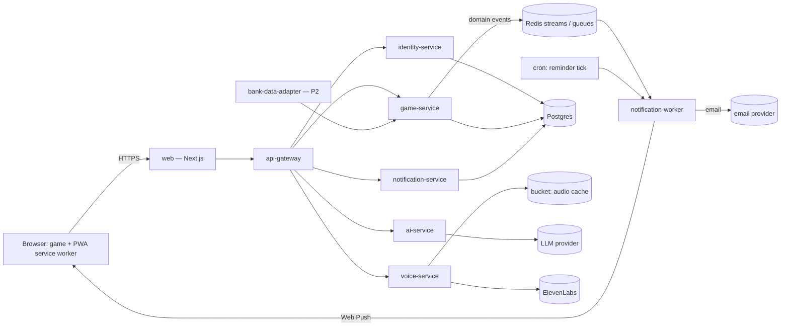
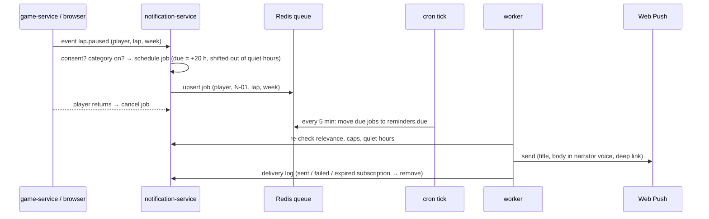

# Backend services — Pilot Płynności

Principles:
1. **One rules engine.** The engine is a shared TypeScript package (`packages/engine`) used by the browser and by the services; no service re-implements money rules.
2. **Smallest backend that does the job per phase.** The 48 h build keeps a thin backend; the service split comes after the event.
3. **Secrets never leave the server side.** Keys are declared in the hosting plan, generated or stored by the platform keychain, entered only through the platform's form — never in chat, repo, client bundle or logs.
4. **Reminders bring the player back to the next move; they never nag and never sell.**

## 1. Phases

| Phase | When | Backend shape |
|---|---|---|
| **H — hackathon slice** | 20–22 XI | Next.js app (`web`) with route handlers as a thin BFF: `/api/agent`, `/api/tts`, `/api/push/*`; Redis for push subscriptions and the demo reminder queue; one `cron` tick; pre-rendered audio in the app; no accounts (guest-first, D-08, D-10) |
| **P1 — pilot** | after the event, if the bank wants a pilot | services split as in §2, Postgres, Redis, bucket, accounts G01–G04, full reminder engine, analytics of learning metrics |
| **P2 — bank integration** | after P1 | bank-data adapter (consent, PSD2 / mBank data, mOrganizer forecast), real account clock, real plan validation, advisor hand-off |

## 2. Service map (P1 target)

## 3. Service catalogue

| Service | Responsibility | Owns data | Key API / events | Phase | Hosting kind |
|---|---|---|---|---|---|
| **web** | game client (SSR + static art), PWA manifest and service worker (push, offline), BFF route handlers in H | — | pages; in H also `/api/agent`, `/api/tts`, `/api/push/subscribe`, `/api/push/demo` | H, P1 | `web` |
| **api-gateway** | one entry for the browser: session check, rate limits, request ids, routing, CORS | — | `/v1/*` | P1 | `service` |
| **identity-service** | accounts G01–G04: sign-up, login, logout, password reset, email verification; guest → account upgrade that merges the local save; GDPR export/delete | users, sessions, reset tokens, consents | `POST /auth/*`; event `user.created`, `user.deleted` | P1 | `service` |
| **game-service** | saves (GameState snapshots per lap), settings (player gender, narrator), plans, account clock; re-runs the shared engine to confirm results before awarding stars and competences; emits domain events | saves, settings, plans, achievements | `GET/PUT /saves`, `POST /plans`, `POST /account-clock/advance`; events `lap.paused`, `lap.completed`, `plan.saved`, `plan.met`, `plan.missed`, `level.unlocked` | P1 (H: browser `localStorage`) | `service` |
| **ai-service** | intent classification and agent replies with the number guardrail; provider abstraction (Claude / Gemini); cache of approved lines | prompt versions, response cache | `POST /intent`, `POST /agent-reply` | H as route, P1 service | `service` |
| **voice-service** | ElevenLabs TTS for dynamic lines; cache keyed by script version + voice + text hash; batch pre-render of the voice script | audio cache (bucket), render log | `POST /tts`, job `voice.prerender` | H as route + build script, P1 service | `service` + `bucket` |
| **notification-service** | reminder preferences and consent, push subscriptions, rules, templates, scheduling, delivery log, unsubscribe | preferences, subscriptions, scheduled jobs, deliveries | `POST /push/subscribe`, `PUT /preferences`, `GET /inbox`; consumes domain events | H minimal, P1 full | `service` |
| **notification-worker** | executes due reminders: re-checks relevance, quiet hours and caps, renders, sends (Web Push, email), records the result | — (writes deliveries) | queue `reminders.due` | H (in the cron tick), P1 | `worker` |
| **reminder-tick** | every 5 minutes enqueues reminders that became due | — | — | H, P1 | `cron` (`*/5 * * * *`) |
| **analytics** | learning metrics for the bank story: competences reached, plans met, avoided cost, return rate after a reminder — anonymised | aggregated metrics | event consumer | P1 | part of game-service or a `worker` |
| **bank-data-adapter** | consent flow, account sync (PSD2 / mBank, mOrganizer forecast), maps real transactions to the ledger, drives the real account clock and plan validation | consents, sync state | events `account.synced`, `transaction.booked` | P2 | `service` + `worker` |

Data stores: **Postgres** (one schema per owning service), **Redis** (queues, rate limits, H-phase subscriptions), **bucket** (audio cache, GDPR exports), CDN for art (served by `web`).

## 4. Player reminder notifications

### 4.1 Goal and rules

Bring the player back to the next decision at the right moment (E-04 „chcą do niej wracać”), in the Boss's voice, without pressure or sales.

| Rule | Value |
|---|---|
| Consent | asked after the first finished week or lap, never on the first screen; per category; off by default |
| Quiet hours | 21:00–08:00 Europe/Warsaw; nothing on Sundays except an opted-in weekly digest |
| Frequency cap | max 1 push per day and 3 per week per player; after 3 ignored reminders in a row → pause for 14 days |
| Relevance check | every reminder is re-checked at send time (player already came back? week already resolved? plan already met?) and dropped if stale |
| Idempotency | one job per (player, trigger, lap, week); cancelled when the player returns |
| Content | Polish, the chosen narrator (Szefowa / Szef) and the player's grammatical gender; numbers only from the engine; a deep link to the exact week or plan |
| Ethics | never mentions a loan, factoring or any product; never uses fear or deadlines that are not in the game; one-tap unsubscribe in every message |
| Privacy | push payload carries no amounts or names of real people beyond the game persona; GDPR delete removes subscriptions and history |

### 4.2 Triggers

| Id | Trigger | Delay / time | Example (Szefowa) | Deep link | Phase |
|---|---|---|---|---|---|
| N-01 | lap paused mid-week (`lap.paused`) | +20 h, inside allowed hours | „Tydzień 3 czeka. Burza 28 grudnia jest coraz bliżej — wracasz za stery?” | `/gra/1?resume=T3` | H, P1 |
| N-02 | lap won, plan not saved | +2 h | „Grudzień dowieziony! Jeszcze jedna gwiazdka czeka — zapisz plan.” | `/podsumowanie` | H, P1 |
| N-03 | level unlocked, not started | +48 h | „Poziom 2 odblokowany. Czas na pierwszego pracownika?” | `/` (map) | P1 |
| N-04 | crash, no retry | +24 h | „Spokojnie, cofnięcie czasu nic nie kosztuje. Spróbujemy inaczej?” | `/gra/1?rewind` | P1 |
| N-05 | plan deadline approaching (account clock, real time) | 1 day before the deadline | „Jutro mija termin zaliczki od Klienta A. Sprawdzimy, czy wpłynęła?” | `/plan` | P1 (synthetic), P2 (real) |
| N-06 | plan met / missed on the account | on `plan.met` / `plan.missed` | „Zaliczka dotarła — luka zamknięta!” / „Zaliczki nie ma. Przećwiczmy wariant B.” | `/plan` | P2 |
| N-07 | real public obligation ahead (ZUS 20th, VAT 25th) | 3 business days before | „Za 3 dni VAT. Przelećmy ten tydzień w symulatorze?” | `/gra/…` scenario | P2 |
| N-08 | weekly digest (opt-in) | Monday 09:00 | „Nowy tydzień firmy: 1 decyzja czeka, 2 gwiazdki do zdobycia.” | `/` | P1 |

Templates come from the copy deck (the design team A6) with ids `notif.N-0x.<variant>`; the push title is always „Pilot Płynności”.

### 4.3 Channels

| Channel | Use | Notes |
|---|---|---|
| **Web Push** (VAPID) | main channel | works in Chrome, Edge, Firefox, Android; on iPhone only for a game installed to the home screen (PWA); the service worker shows the notification and opens the deep link |
| **In-app inbox** | always | badge on the map; the same items as push; the only channel without consent beyond the game itself |
| **Email** | fallback for players with an account who opt in | transactional provider, P1 |
| SMS | not used | (and in the game SMS is the trap channel) |

### 4.4 Flow

### 4.5 Data (notification-service)

| Table | Fields |
|---|---|
| `push_subscription` | id, player_id, endpoint, p256dh, auth, user_agent, created_at, last_ok_at |
| `notification_preference` | player_id, category (progress, plans, digest, real_obligations), enabled, quiet_from, quiet_to, timezone |
| `scheduled_notification` | id, player_id, trigger, lap, week, due_at, status (scheduled / cancelled / sent / dropped), dedupe_key |
| `notification_delivery` | id, scheduled_id, channel, sent_at, result, clicked_at |
| `ignored_streak` | player_id, count, paused_until |

In phase H a guest is identified by a random `player_id` stored in the browser; Redis holds the subscription and the jobs; no other personal data.

## 5. API sketch (P1, through the gateway)

| Method | Path | Service |
|---|---|---|
| POST | `/v1/auth/signup`, `/login`, `/logout`, `/reset`, `/reset/confirm`, `/verify` | identity |
| POST | `/v1/auth/upgrade-guest` (merge local save) | identity + game |
| GET / PUT | `/v1/saves/:lap` | game |
| POST | `/v1/plans`, `/v1/account-clock/advance` | game |
| POST | `/v1/ai/intent`, `/v1/ai/agent-reply` | ai |
| POST | `/v1/voice/tts` | voice |
| POST / DELETE | `/v1/push/subscription` | notification |
| GET / PUT | `/v1/notifications/preferences`, GET `/v1/notifications/inbox` | notification |
| GET | `/v1/unsubscribe/:token` (one tap, no login) | notification |

## 6. Security, privacy, secrets

- Sessions: httpOnly, Secure, SameSite cookies; short-lived access token, refresh in identity-service; rate limits on auth and AI/TTS routes (cost control).
- GDPR: consent records for notifications and (P2) bank data; export and delete; retention of delivery logs 90 days; no PII in logs.
- Secrets (declared by name in the hosting plan, referenced in `env`): `LLM_API_KEY`, `ELEVENLABS_API_KEY`, `VAPID_PUBLIC_KEY` (not secret, exposed to the browser), `VAPID_PRIVATE_KEY`, `DATABASE_URL`, `REDIS_URL`, `EMAIL_API_KEY` (P1), `SESSION_SECRET` (P1). Generated by the platform where it can (VAPID pair, session secret), otherwise entered by the product owner through the platform's variable form; never pasted in chat.
- Cost guards: per-player daily caps on dynamic TTS and LLM calls; cached and pre-rendered lines first.

## 8. The 48 h slice (what is really built at the event)

| Item | Priority | Note |
|---|---|---|
| `/api/agent`, `/api/tts` route handlers + pre-rendered audio | MUST / SHOULD | as DEMO-REQUIREMENTS GM-04, GM-20, GM-21 |
| In-app return banner („Wróciłaś! Tydzień 3 czeka.”) from `localStorage` | SHOULD | no backend |
| Web Push opt-in after the first lap + `/api/push/subscribe` + Redis | SHOULD (GM-27) | desktop Chrome on the pitch laptop |
| Demo reminder: „Przypomnij mi” → push after 30 s on stage (N-01 text) | SHOULD (GM-27) | shows the comeback loop to the jury |
| cron tick + worker logic for N-01 / N-02 | COULD | real delays; caps and quiet hours in code |
| Accounts, Postgres, split services, email | WON'T in 48 h | P1 |

## 9. Open decisions

| Id | Decision | Recommendation |
|---|---|---|
| OD-6 | Reminders in the hackathon demo | SHOULD: opt-in after the first lap, Web Push demo reminder on stage + in-app return banner |
| OD-7 | Hosting the hackathon build on the hosting platform vs a plain Vercel preview | The hosting platform `web` + `redis` + `cron` if the plan can be applied before hour 6; local build stays the fallback |
| OD-8 | P1 repository shape | the team's standard monorepo (apps/web, microservices/*, packages/engine) when a pilot is agreed |
| OD-9 | Email provider for P1 | decide with the bank pilot (EU data residency) |

## 10. Decided after writing

- **OD-6 → D-14 (2026-11-16):** the hackathon demo includes the Web Push demo reminder and the in-app return banner; GM-27 is MUST with the banner as the fallback. For §8 this means: `/api/push/subscribe`, `/api/push/demo` (delayed send, 30 s) and Redis are MUST; the cron tick with real delays (GM-28) stays COULD. Pre-event: declare `VAPID_PUBLIC_KEY` / `VAPID_PRIVATE_KEY` and `REDIS_URL` in the hosting plan so the platform can generate or provision them.

- **Aligned with NOTIFICATION-DESIGN.md (the design team, 2026-11-16):** the one-tap unsubscribe is two steps on the server side: `GET /v1/unsubscribe/:token` only shows a landing page (mail scanners prefetch links), `POST /v1/unsubscribe/:token` changes the preference; reminder emails also carry `List-Unsubscribe` with `List-Unsubscribe-Post: List-Unsubscribe=One-Click` (handled by the same POST). N-07 is scheduled 3 business days before the obligation, and its body states the real calendar-day difference. Templates, layouts and grammar variants of N-01…N-08: NOTIFICATION-DESIGN.md and `design/notifications/`.

- **Example texts in §4.2 superseded by the copy deck:** the final wording of N-01…N-08 is in `design/notifications/notification-copy.pl.json`. In particular N-01 does not say the storm is "getting closer" — game time does not move while the player is away („Tydzień 3 czeka. Wrócisz za stery?”). The demo trigger for D-14 (`notif.demo.*`) and editable channels/quiet hours in G36 were requested from the design team on 2026-11-16.
