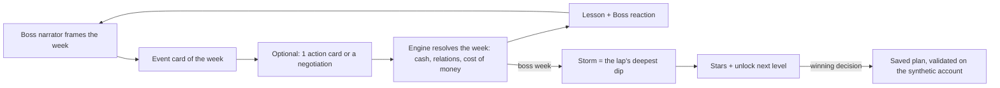

# Game design — „Lot przez rok firmy” (A-7, adopted by D-04)

**Status: the game is the hackathon demo (D-04).** Web game in the browser on desktop and mobile landscape (D-03, D-10), a colourful illustrated adventure with a Boss narrator (D-05, D-06, D-08, D-12). This document holds the **rules and numbers**; GAME-EXPERIENCE-AND-NARRATION.md holds the look, story and voice; ENGINE-DATA-AND-TESTS.md turns these rules into data tables and test cases. Where they meet, numbers and rules come from here. No code before the start (D-01).

It is an original game: the board is a flight route over the firm's own calendar, not the square board or the property-trading rules of any commercial board game. Do not use any existing game's name, board, cards or look.

## 1. Why

Concept v2 was a decision simulator without a quest (G-14). The game keeps what holds — deterministic engine, AI explains only, avoided cost, competences earned by action, ethics — and wraps it in a loop the jury can play in 60 seconds.

## 2. Core loop

- **Turn = one calendar week (Mon–Sun)**, deterministic: obligations fall on their real dates.
- **Randomness = the event deck**, seeded; the demo seed fixes the order.
- **One optional action per week**; resolving the week's event is not the action. Inspecting the Cash Flow, previews and AI-CFO hints are free.
- **Safe failure:** the lap stops at the first rejected payment; „Cofnij czas” restores a chosen earlier week.

## 3. Board, HUD, Cash Flow

- **Board = flight route over 7 week islands**: 23 XI, 30 XI, 7 XII, 14 XII, 21 XII, 28 XII, 4 I; finish 10 I. Markers: ZUS + PIT (20th, next business day → 21 XII), VAT (25th, next business day → 25 XI, 28 XII). The deepest forecast dip is the **storm** (28 XII, −12 395 zł without action).
- **HUD:** Gotówka (zł) · Paliwo (runway days = balance ÷ 900, 42 at start) · Odporność (engine score, em dash until calibrated) · Relacje (start 5/5, hearts) · Koszt pieniądza (zł, sum over the lap).
- **Cash Flow (Alan, D-09):** opened from any week node or the „Pokaż przepływy” button; daily balance with dates, zero line, baseline vs preview vs committed, and the dated transaction list. Opening it never spends the week.

## 4. Characters and roles (D-12)

**Story:** the graphic studio belongs to the Boss — Szefowa (default; she is Ania, the persona of SYNTHETIC-DATA.md) or Szef. The player is the new „pilot finansów” the Boss brought in to help steer the firm's money through December: a helper/partner, not an employee, so level 2 „Pierwszy pracownik” is still the firm's first hire. The firm's numbers are the same for every choice.

| Character | Role in the rules | Notes |
|---|---|---|
| **Player** — „pilot finansów” (woman / man, chosen) | makes every decision | gender changes avatar and grammar only (D-08) |
| **Szefowa / Szef** — owner of the studio, narrator (chosen) | frames weeks, reacts to engine events with emotions, owns the firm's money | never decides or computes; reactions are triggered by engine events (GAME-EXPERIENCE §5) |
| **AI-CFO** (copilot robot) | 1 hint per week (risk + 2 options with engine cost); „Deleguj turę” plays the cheapest valid action | delegated decision → competence 1, own decision → 2; the Boss may voice its hint |
| **Klient A** (55 % of revenue) | negotiation agent | rules table below |
| **Doradca banku** | offers the overdraft, shows full cost, says when it is not needed | **never offers the non-bank loan** (that comes as an SMS from a non-bank lender) |

AI never decides an amount: every agent has a deterministic rules table; the LLM only voices it and classifies free text into intents. If the model fails or takes > 3 s, the same dialogue runs on buttons with cached lines.

| Agent | Rules |
|---|---|
| Klient A | Advance ≤ 30 % only in T1–T2; asked > 30 % → counter-offer 30 % (15 000 zł by 3 XII); T3+ → „budżet zamknięty”. Early-payment discount 2 %: accepts, pays 3 calendar days after the offer (fixture: offer 15 XII → 18 XII). Rudeness → refuses, Relacje −1. 3 messages per turn. |
| Doradca banku | Overdraft 15 000 zł: application cutoff end of T3 (game constraint); cost computed by the engine (§6.1). |

## 5. Level progression

| Level | Lap | Boss | Unlocks | 48 h status |
|---|---|---|---|---|
| 1 „Przetrwaj grudzień” | 7 weeks, 23 XI 2026 → 10 I 2027 | storm 28 XII, −12 395 zł | competences Luka płynnościowa, Koszt pieniądza, Bezpieczne płatności; level 2 | **MUST** |
| 2 „Pierwszy pracownik” | Q1 2027 | first payroll: payroll 10th, ZUS moves to the 15th, cost ≈ 120 % of gross | Rezerwa podatkowa; level 3 | SHOULD (3 weeks) |
| 3 „Rozwój i inwestycje” | Q2 2027 | hire / CAPEX / lease / software; surplus cash vs tax reserve | Kapitał obrotowy | COULD (teaser) |
| 4 „Następne pokolenie” | vision | handing the firm over | — | vision only |

Level 3 is where investing enters; the game shows mechanics and costs, never recommends a product.

## 6. Level 1 — content and numbers

### 6.1 Action cards (one per week, each once per lap; keys 1–6)

| # | Card | When | Engine effect | Low (zł) | Cost of money (zł) | Relacje | Lesson |
|---|---|---|---|---|---|---|---|
| 1 | Poproś o zaliczkę (negotiation with Klient A) | T1–T2 | +15 000 on 3 XII | **+2 605**; demo seed lap end 9 985 | 0 | = | Luka płynnościowa: ask before work starts |
| 2 | Zaproponuj skonto 2 % | offer by T4 | 20 295 → 19 889, 3 calendar days after the offer, instead of 8 I | **+7 494** | 406 | = | a discount is cheap credit |
| 2′ | same, too late | T5 | money after 22 XII (25 XII is a holiday → 28 XII, U-12) | crash 22 XII (−8 095) | 406 | = | timing beats the tool |
| 3 | Przesuń płatność podwykonawcom | before T5 | −35 700 moved to 8 I | without T6 +15 280 · **demo seed: crash 8 I (−5 015)** | 0 | **−2** | postponing moves the problem |
| 4 | Limit w koncie 15 000 zł (Doradca banku) | apply by end of T3 | balance may reach −15 000 | −12 395 inside the limit | 150 fee + 12 %/yr on the actual negative balance; **≈ 194 in the demo seed** | = | prepare financing in advance |
| 5 | Pożyczka w 15 minut (non-bank, via SMS) | T1–T5 | +15 000 on the Monday of the week played (fixture T5: 21 XII), −17 400 on 20 I | +2 605 | **2 400** flat | = | fastest ≠ cheapest |
| 6 | **Faktoring ekspresowy mBank** (D-09, D-11) | T1–T5, invoice not discounted | Klient A's 20 295 zł invoice financed: +19 991 on the next business day after the Monday request (T1 24 XI … T5 22 XII); the 8 I receipt goes to the factor | **+7 596**; lap end 14 976 | **304** (1.5 %, synthetic scenario) | = | invoice financing in context; compare with the free advance |

Avoided cost vs the default (the loan, 2 400 zł): advance 2 400 · discount 1 994 · factoring 2 096 · overdraft ≈ 2 206.

### 6.2 Event deck (demo seed)

| Week | Card | Choices and effect | Lesson |
|---|---|---|---|
| T1 | „Nowy numer konta podwykonawcy” — invoice 35 700 zł, account number changed | **Sprawdź na białej liście i zadzwoń** → Bezpieczne płatności 2, no money effect · **Zapłać jak jest** → the 22 XII payment goes to a fraudster, reported on 23 XII, paid again 8 I → crash 8 I | VAT white list for B2B payments > 15 000 zł (wording verified by the finance role before the pitch) |
| T2 | „Klient C: nowe zlecenie 6 000 zł netto” — subcontractor 3 000 zł on 14 XII, payment late January | accept → low 3 000 deeper; **with the advance: crash 28 XII (−395)**, rescued by discount or factoring (low +19 596) or overdraft; decline → none | profitable ≠ liquid |
| T3 | „Narzędzie AI do grafiki 400 zł / mies.” | now → −400 on 15 XII; from January → none | investment timing |
| T5 | „SMS: pożyczka 15 000 w 15 minut” | appears only while the gap is open; shows card 5 | cost of money |
| T6 | „Klient A spóźni się kolejne 14 dni” | 8 I → 22 I (outside the lap); no effect after discount or factoring | concentration risk |

### 6.3 Crash, stars, competences, unlock

- **Crash:** a public obligation or committed payment cannot be paid from balance + available overdraft → „Przelew odrzucony” with cause, date and shortfall; Boss reaction then „Cofnij czas”.
- **Stars** (independent, max 3; Pilot finalised on plan save): ★ Przetrwanie — all paid on time · ★ Tanio — cost of money ≤ 500 zł and Relacje not lowered · ★ Pilot — own balance never below 0 and a winning decision saved as the plan.
- After plan save: advance ★★★ · discount ★★★ · factoring ★★★ · overdraft ★★ (Przetrwanie + Tanio) · loan ★★ (Przetrwanie + Pilot), ★ without plan · postponement: crash in the demo seed. Before save, Pilot is shown pending.
- **Competences** are milestones: 0 unpractised · 1 observed/delegated · 2 own decision · 3 validated on the (synthetic) account. Buying a product (overdraft, loan, factoring) never raises a competence. Achievement nicknames (GAME-EXPERIENCE §8) only decorate these milestones.
- **Level 2 unlocks** at lap completion with ≥ 1 star; account validation only raises a competence.

### 6.4 From the game to the account

The winning decision becomes a plan (e.g. „Zaliczka 15 000 zł ±10 % od Klienta A do 4 grudnia”). The **account clock** is separate from the game clock: it starts at 21 XI; „Przewiń czas o 2 tygodnie” reaches 5 XII, replays SYNTHETIC-DATA §4, the plan matcher confirms the 3 XII advance → competence 3. Synthetic account replay, labelled; no bank connection.

### 6.5 Edge rules (D-07, D-11)

| Id | Rule |
|---|---|
| U-1 | „Zapłać jak jest” = fraud as in §6.2; the card shows the red flag and AI-CFO warns, so the outcome is fair. |
| U-2 | Several cards per lap, one per week, each once; effects and costs add up; stars use totals; the player picks which played decision becomes the plan. |
| U-3 | Postponement crashes on 8 I in the demo seed; kept on purpose; the card warns. |
| U-4 | Overdraft cost computed by the engine (≈ 194 zł in the demo seed), labelled „szacunek”. |
| U-5 | Discount money 3 calendar days after the offer. |
| U-6 | Any winning decision can be saved as the plan. |
| U-7 | Advance + Klient C's order crashes on 28 XII; kept; rescue paths exist. |
| U-8 | Loan money on the Monday of the week played; 2 400 zł flat; not after the 22 XII payment. |
| U-9 | Odporność is engine-only. |
| U-10 | Same date: inflows before outflows. |
| U-11 | Factoring and discount use the same invoice: playing one disables the other („Faktura już sfinansowana / już opłacona”). |
| U-12 | Business days: an inflow or obligation that falls on a weekend or a holiday (24, 25, 26 XII, 1 I, 6 I) moves to the next business day — the same rule the ledger already uses for ZUS/PIT (20 XII → 21 XII) and VAT (25 XII → 28 XII). In level 1 it changes one date only: the discount offered in T5 pays on 28 XII instead of 25 XII; the outcome (crash 22 XII) is unchanged. |

### 6.6 Factoring card details (D-09, D-11)

Title as requested by Alan: „Faktoring ekspresowy mBank”, plain text, no logo, no bank styling; labels „Koszt: 1,5%”, „Założenie scenariusza”, „Dane syntetyczne”. Fee base = gross invoice 20 295 zł; fee 304 zł rounded to the złoty; financed 100 % (simplification); recourse beyond the lap not modelled. Boss line: „Faktura ma termin. My mamy poniedziałek.” The comparison (G31) always shows the free advance while it is still valid. Winning never requires the named product. The 1.5 % is not an mBank tariff; name and terminology validated with the challenge mentors before the pitch (Q-09).

## 7. Reuse and engine modules

Engine (pure TS, Vitest): forecast, `turn`, `cards` (overlays), `agents` (rules tables), `score` (stars, relations, cost of money, competences), `deck` (seed), `matcher` (plan), `cashflow` (series + transactions for the drilldown). Data: `persona.json`, `level1.json`, `agents.json`, `future-script.json`, `reactions.json` — exact tables and the Vitest case list in ENGINE-DATA-AND-TESTS.md. Details: ARCHITECTURE.md.

## 8. Story list

The binding MoSCoW list is DEMO-REQUIREMENTS.md; the build order and cut lines are in BUILD-PLAN.md.

## 9. Demo click-path (≈ 90 s, pitch 0:45–2:15, `/gra/1?seed=demo`)

Pitch defaults (OD-4): Szefowa as the Boss, player woman.

1. Szefowa greets her new „pilot finansów” in one voiced line (G05), skip to the map (G09): „Przetrwaj grudzień” active, three levels in fog.
2. Board (G10): the December route, storm on 28 XII „−12 395 zł”.
3. T1 event (G11): changed account number → „Sprawdź i zadzwoń” → Bezpieczne płatności 2.
4. T1 negotiation (G14): „50% zaliczki?” → „Mogę dać 30% — 15 000 zł do 3 grudnia” → accept.
5. Tap the 28 XII node (G30, Alan's Cash Flow): before −12 395 zł, after +2 605 zł, with the transactions.
6. Resolve T2–T7 with one tap per event (decline Klient C, AI tool from January, acknowledge late Klient A); storm passed, lap end 9 985 zł → summary (G18): ★ Przetrwanie, ★ Tanio, ☆ Pilot pending, „Unikasz 2 400 zł”.
7. „Zapisz plan” → ★★★, level 2 unlocks → „Przewiń czas o 2 tygodnie” (account 21 XI → 5 XII) → „Zaliczka dotarła”, Luka płynnościowa 3 (G23). Close: Szefowa: „Przeszliśmy grudzień w grze, zanim przeszliśmy go na koncie.”

Factoring is shown on the bank-value slide via G31 (comparison), not on the 90 s path.

## 10. Platform (D-03, D-10)

| Topic | Rule |
|---|---|
| Targets | Browser only. Desktop 1440×900 (projector check 1280×800) and **mobile landscape** 844×390 (also 812×375, 932×430); portrait phone shows „Obróć telefon, lecimy w poziomie” with reachable help. No native/Electron app. |
| Input | Mouse, touch, keyboard: 1–6 select cards outside text fields; Enter/Space activate the focused control; Esc closes panels; targets ≥ 44 px. |
| Rendering | Layered illustrations (static WebP/PNG) behind a live HTML/SVG play layer; numbers and text are always live, never baked into art. |
| Performance | First load < 2 s from the deployed build (first-load art ≤ 1.5 MB); turn resolves and animates < 300 ms; Cash Flow recompute < 200 ms. |
| State | Local game state in `localStorage`; reset clears it. No auth backend in the hackathon build (guest-first, D-08, D-10). |
| Offline | Local build on two laptops; agents fall back to buttons, voice falls back to captions. |
| Accessibility | AA text contrast, captions always, reduced motion, no meaning by colour alone, keyboard path through the demo. |

## 11. Demo path addition — the comeback loop (D-13, D-14)

8. After „Zapisz plan”, Szefowa offers reminders; the player taps „Przypomnij mi” (opt-in). During the bank-value slide the demo reminder arrives (N-01: „Tydzień N czeka…”, BACKEND-SERVICES §4.2); a click reopens the game with the return banner. Fallback without push: the banner only. Reminders never mention products and respect quiet hours and caps (BACKEND-SERVICES §4.1).
